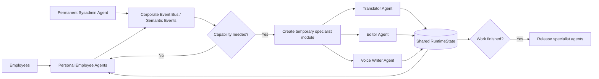

# Elastic Corporate Agent Network

**Mozaik Freestyle 2026 submission — JigJoy / NTP Novi Sad AI Hackathon**

> The company does not have a fixed number of AI agents. The agent workforce is created dynamically from employee profiles and business scenarios.
>
> **Agents exist only when the company needs them.**

Live product: **https://agents.koretskiy.com**  
Render fallback: **https://mozaik-agent-network.onrender.com**

## How to use the product

The live product has two connected modes: **Architecture** and **Live Voice**.

### 1. Architecture demo

1. Open **https://agents.koretskiy.com** in Google Chrome.
2. The first screen shows the current corporate AI workforce: one permanent Sysadmin Agent plus active Personal Employee Agents.
3. Click **Run elastic workforce demo**.
4. Watch the active-agent counter and lifecycle trace.
5. A temporary **Communication Module** appears with three specialist agents.
6. Watch the specialist agents work concurrently and coordinate through shared state.
7. When the specialist work is complete, the temporary module is released automatically.
8. The demo then shows an employee joining and two employees leaving, so the workforce expands and contracts dynamically.
9. The expected lifecycle is:

```text
4 → 7 → 4 → 5 → 4 → 3
```

The **Sysadmin event stream** at the bottom shows the corresponding runtime events.

### 2. Live Voice mode

You can enter Live Voice at any time using **Live Voice** in the top bar, or use the **Enter Live Voice Mode** button after the architecture demo completes.

1. Choose the **Input language**.
2. Choose the **Output language**.
3. Choose an output style: **Faithful**, **Polite & clean**, or **Business**.
4. Choose a voice preference: **Auto**, **Female presentation**, **Male presentation**, or **Neutral presentation**.
5. Keep **Voice output = Auto** if you want spoken AI output, or set it to **Off** for text-only output.
6. Click **Start microphone**.
7. Speak a short phrase normally.
8. Watch the Source, Translator, Editor and Voice Writer agent statuses progress.
9. Read the recognised original text, translation and generated voice script.
10. If voice output is enabled, the AI-generated spoken version plays automatically.
11. Use **Save voice MP3** if you want to save the generated spoken output.
12. Use **Clear** to reset the current Live Voice session.

Privacy behaviour is intentional: the microphone starts only after your click, stops after about 20 seconds of silence, stops when the page/window loses focus, and never resumes automatically.

### Recommended browser

**Google Chrome on desktop or Android.**

The architecture demo works as a standard web interface, but Live Voice depends on browser speech-recognition and microphone behaviour, which are most reliable in Chrome.

## What it is

Elastic Corporate Agent Network is a working multi-agent corporate runtime built on Mozaik.

Instead of running one permanent chatbot with a collection of tools, the system creates and removes actual agents as the company changes and as temporary specialist work appears.

The final showcase contains two connected experiences inside one application:

1. **Elastic workforce architecture demo** — personal employee agents join and leave dynamically, while temporary specialist teams are created on demand and released after the task is complete.
2. **Live multi-agent voice communication** — a concrete Communication Module where translation, editorial work and natural spoken output are coordinated by multiple agents.

The voice workflow is one use case of the architecture, not the whole product.

## Why this is useful

A real company does not need every AI specialist active all the time.

An employee may need translation now, legal review later, planning tomorrow, and no specialist module at all for the rest of the day. A fixed fleet wastes resources and does not reflect the organisation's actual state.

This project models AI capacity as an **elastic workforce**:

- a permanent **Sysadmin Agent** monitors the network;
- each active employee can have a **Personal Agent**;
- employee agents can join and leave at runtime;
- business needs trigger temporary specialist modules;
- specialist agents coordinate through shared runtime state;
- finished modules are torn down automatically.

This architecture can later support Communication, Legal, Meeting, Planner, Protocol, Document, Compliance and Negotiation modules without changing the core lifecycle model.

## Main demo

The architecture scenario starts with three employees plus the permanent Sysadmin Agent.

A communication request triggers a temporary three-agent specialist module. After the work is complete, the module disappears. A fourth employee then joins, and two employees later leave.

The visible lifecycle is:

```text
4 → 7 → 4 → 5 → 4 → 3
```

Meaning:

```text
1 Sysadmin + 3 Personal Agents
              ↓
1 Sysadmin + 3 Personal Agents + 3 Specialists
              ↓
specialist module released
              ↓
4th employee joins
              ↓
James leaves
              ↓
Marko leaves
```

The UI shows the active-agent count, workforce composition, module lifecycle and Sysadmin event stream while the topology changes.

## Architecture



## Why this is genuinely multi-agent and concurrent

The hackathon requirement is not satisfied by one chatbot calling multiple tools. This project uses multiple Mozaik agents with separate identities, lifecycle and shared state.

During a Communication Module request:

1. **Translator Agent** begins producing the translation.
2. **Editor Agent** and **Voice Writer Agent** perform parallel pre-analysis while translation is in progress.
3. Translator output is written into shared request state.
4. Editor and Voice Writer consume that shared draft and complete their coordinated final passes.
5. Results are written back to shared state for the requesting employee agent.
6. When the module becomes idle, the temporary agents are removed.

So the coordination pattern is:

```text
parallel analysis
      ↓
shared state
      ↓
coordinated final outputs
```

The system also experimentally validates that agents created **after runtime start** can join, receive Semantic Events, perform real model inference, leave the runtime, and later be replaced by fresh agent instances.

## Mozaik concepts used

The project uses Mozaik as the core runtime rather than as a thin wrapper around a single model call.

Key concepts used in the implementation:

- dynamic `createAgent(...)`
- runtime `join(...)` and `leave(...)`
- `SemanticEvent`
- shared `RuntimeState`
- multiple simultaneous participants
- dynamically created specialist agents
- event-driven coordination
- dynamic agent inference after runtime start
- Mozaik Cloud observability

## Live Voice Mode

The same hosted product includes a live multilingual Communication Module.

Supported languages:

- English
- Serbian
- Ukrainian
- Russian

The flow is:

```text
Microphone
   ↓
Browser speech recognition
   ↓
Source Agent
   ↓
Translator Agent
   ↓
Editor Agent
   ↓
Voice Writer Agent
   ↓
OpenAI AI speech output
```

The interface shows:

- live original text;
- translated output;
- agent status;
- voice script;
- latency;
- AI voice playback;
- downloadable MP3 output.

### Voice preference

Employee and user profiles can include a communication **voice preference** such as male, female or neutral presentation.

This is intentionally a presentation preference rather than a stored employee gender attribute.

## Privacy behaviour in Live Voice

The demo uses an explicit privacy-first microphone policy:

- the microphone starts only after a user action;
- a clear indicator shows `MIC LIVE`, `MIC PAUSED` or `MIC OFF`;
- the microphone automatically stops after about 20 seconds of silence;
- it stops when the page is hidden;
- it stops when the browser window loses focus;
- it stops when the user leaves the page;
- it **never automatically resumes** after focus returns.

Chrome is used for speech recognition. Spoken output is generated through OpenAI TTS.

The public demo does not use an application database to permanently store Live Voice transcripts. Working state and generated-audio cache are held in server memory and disappear when the process restarts.

See the hosted **Privacy Policy** and **Terms of Use** for the public demo.

## Resilience

Temporary specialists have bounded model-call time.

Each real LLM specialist pass has a timeout. If a specialist times out:

- it is marked timed out / quarantined for the current module;
- the current task falls back instead of blocking the whole workflow;
- remaining work can continue;
- late model answers are ignored;
- timers are cleared when the module is torn down.

This keeps one slow specialist from freezing the full corporate network demo.

## Real LLM and fallback mode

If `OPENAI_API_KEY` is available and `NETWORK_LLM` is not set to `0`, the Communication Module uses real model inference.

Without an API key, the architecture can still run in fallback mode so the lifecycle and coordination mechanics remain demonstrable.

AI speech output requires `OPENAI_API_KEY`.

## Run locally

Requirements:

- Node.js 24+
- npm
- optional but recommended: `OPENAI_API_KEY`

```bash
npm install
export OPENAI_API_KEY="your-key"
npm start
```

Then open:

```text
http://localhost:3002
```

The server also honours the hosting provider's `PORT` environment variable.

Do not commit API keys to the repository.

## Production-style hosted run

The final showcase is designed to run as a **persistent single Node.js process** because the Mozaik runtime and current shared state live in memory.

Current hosted deployment:

```text
Render Web Service
Runtime: Node.js
Build:   npm install
Start:   npm start
Region:  Frankfurt
Instances: 1
```

Health endpoints:

```text
/health
/healthz
```

Example response includes service status, uptime and whether OpenAI is configured.

## Browser support

**Optimized for Google Chrome on desktop and Android.**

The architecture interface itself is standard responsive web UI. Live Voice depends on browser speech-recognition and microphone behaviour, which are most reliable in Chrome. Other browsers may have limited or unavailable speech recognition.

## Demo flow for judges

Recommended path:

1. Open the live product.
2. Note the initial active-agent count: Sysadmin + three employee agents.
3. Click **Run elastic workforce demo**.
4. Watch the Communication Module appear with three temporary specialists.
5. Observe concurrent specialist activity and shared-state coordination.
6. Watch the specialist module disappear after completion.
7. Watch Sarah join from Tel Aviv.
8. Watch James and Marko leave and capacity contract automatically.
9. Confirm the lifecycle trace `4 → 7 → 4 → 5 → 4 → 3`.
10. Enter **Live Voice Mode**.
11. Choose source/target languages and voice preference.
12. Start the microphone and speak one phrase.
13. Watch Source, Translator, Editor and Voice Writer agents progress.
14. Hear the AI-generated spoken output or save it as MP3.
15. Switch away from the tab/window and confirm the microphone stops automatically for privacy.

## Smoke tests

The repository includes focused tests for the dynamic behaviour that the final product relies on.

### Dynamic join and event delivery

```bash
npm run dynamic-test
```

Validates that an employee agent created after runtime start can join and receive Semantic Events.

### Full lifecycle

```bash
npm run lifecycle-test
```

Validates:

```text
create → join → receive → leave → ignore later event → recreate → join → receive
```

### Dynamic real inference

```bash
npm run inference-test
```

Validates that a dynamically created agent can join an already running Mozaik runtime, perform real model inference, and then be removed.

## Available scripts

```text
npm start                 Final integrated Product 3
npm run showcase3         Same final integrated product
npm run network-demo      Standalone Corporate Agent Network backup demo
npm run web               Standalone original Live Translator backup demo
npm run dynamic-test      Dynamic join smoke test
npm run lifecycle-test    Dynamic lifecycle smoke test
npm run inference-test    Dynamic real-inference smoke test
npm run demo              Early text-pipeline demo
npm run showcase          Historical two-process launcher
```

The two older standalone products remain in the repository intentionally as working backup demonstrations. The hackathon submission should be judged primarily through `npm start` / Product 3.

## Repository structure

```text
src/
  showcase3.js              final product entry point
  showcase3-server.js       unified server and API routes
  network-runtime.js        corporate network shared runtime
  network-agents.js         Sysadmin, personal agents, specialist modules
  runtime.js                voice workflow shared runtime
  agents.js                 voice workflow agents
  dynamic-agent-*.js        lifecycle/inference smoke tests

public-showcase3/
  index.html                final integrated UI
  app.js                    Product 3 frontend logic
  privacy-guard.js          microphone focus/privacy guard
  styles.css                final responsive UI
  terms.html                Terms of Use
  privacy.html              Privacy Policy
  contact.html              Contact page
```

## Product idea beyond the hackathon

The Communication Module demonstrates the pattern with multilingual communication, but the architecture is designed to extend to other temporary specialist teams.

For example:

```text
Employee request
      ↓
Personal Agent
      ↓
Sysadmin detects capability requirement
      ↓
Agent Factory / lifecycle service
      ↓
Legal Module
 ├─ Contract Analyst
 ├─ Risk / Compliance Agent
 └─ Legal Editor
      ↓
Shared state
      ↓
Reviewed result returned to employee
      ↓
Legal Module released
```

The same lifecycle can support meetings, planning, document processing, compliance or negotiation while preserving the central idea:

> **AI capacity follows the organisation's actual needs instead of remaining permanently allocated.**

## Legal and contact

Public demo pages:

- `/terms.html`
- `/privacy.html`
- `/contact.html`

Contact:

**Oleksandr Koretskiy**  
Koretskiy Consulting  
office@koretskiy.rs  
https://koretskiy.com  
Serbia

---

Built for **Mozaik Freestyle 2026 · JigJoy / NTP Novi Sad AI Hackathon**.
