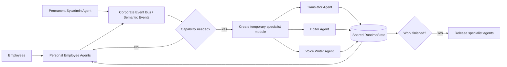

# Elastic Corporate Agent Network

**Mozaik Freestyle 2026 submission — JigJoy / NTP Novi Sad AI Hackathon**

> The company does not have a fixed number of AI agents. The agent workforce is created dynamically from employee profiles and business scenarios.
>
> **Agents exist only when the company needs them.**

**Live product:** https://agents.koretskiy.com  
**Render fallback:** https://mozaik-agent-network.onrender.com

## What it is

Elastic Corporate Agent Network is a working multi-agent corporate runtime built on Mozaik.

Instead of one permanent chatbot with many tools, the system creates and removes actual agents as employees join or leave and as temporary specialist work appears.

The final product has two connected modes:

1. **Architecture demo** — Personal Employee Agents join and leave dynamically, while a temporary specialist team is created on demand and released after the task is complete.
2. **Live Voice** — a concrete Communication Module where several agents coordinate multilingual communication and spoken output.

The voice workflow is one use case of the architecture, not the whole product.

## Why this is useful

A real company does not need every AI specialist active all the time.

An employee may need translation now, legal review later, planning tomorrow, and no specialist module for the rest of the day. This project models AI capacity as an **elastic workforce**:

- one permanent **Sysadmin Agent** monitors the network;
- active employees have **Personal Agents**;
- employee agents can join and leave at runtime;
- business needs trigger temporary specialist modules;
- specialist agents coordinate through shared runtime state;
- finished modules are torn down automatically.

The same lifecycle can later support Legal, Meeting, Planner, Protocol, Document, Compliance and Negotiation modules.

## How to use the product

The live product is optimized for **Google Chrome on desktop and Android**.

### 1. Architecture demo

1. Open https://agents.koretskiy.com.
2. The first screen shows one permanent Sysadmin Agent and three Personal Employee Agents.
3. Click **Run elastic workforce demo**.
4. Watch the active-agent counter, lifecycle trace and Sysadmin event stream.
5. A temporary **Communication Module** appears with three specialist agents.
6. The specialists work concurrently and coordinate through shared state.
7. When the work is complete, the temporary module is released automatically.
8. A fourth employee joins, then two employees leave.
9. Confirm the lifecycle trace:

```text
4 → 7 → 4 → 5 → 4 → 3
```

Meaning:

```text
1 Sysadmin + 3 Personal Agents
              ↓
1 Sysadmin + 3 Personal Agents + 3 Specialists
              ↓
specialist module released
              ↓
4th employee joins
              ↓
James leaves
              ↓
Marko leaves
```

### 2. Live Voice

Enter Live Voice from the top bar, or use **Enter Live Voice Mode** after the architecture demo.

1. Choose **Input language** and **Output language**.
2. Choose output style: **Faithful**, **Polite & clean**, or **Business**.
3. Choose voice preference: **Auto**, **Female**, **Male**, or **Neutral presentation**.
4. Keep **Voice output = Auto** for spoken output, or choose **Off** for text only.
5. Click **Start microphone** and speak a short phrase.
6. Watch Source, Translator, Editor and Voice Writer agent statuses.
7. Read the recognised original, translation and generated voice script.
8. Hear the AI-generated voice output or use **Save voice MP3**.
9. Use **Clear** to reset the current voice session.

Privacy behaviour is intentional: the microphone starts only after a click, stops after about 20 seconds of silence, stops when the page/window loses focus, and never resumes automatically.

## Architecture



## Why this is genuinely multi-agent and concurrent

The hackathon requirement is not satisfied by one chatbot calling several tools. This project uses multiple Mozaik agents with separate identities, lifecycle and shared state.

During a Communication Module request:

1. **Translator Agent** begins producing the translation.
2. **Editor Agent** and **Voice Writer Agent** perform parallel pre-analysis while translation is in progress.
3. Translator output is written into shared request state.
4. Editor and Voice Writer consume that shared draft and complete coordinated final passes.
5. Results are written back to shared state for the requesting employee agent.
6. When the module becomes idle, the temporary agents are removed.

Coordination pattern:

```text
parallel analysis
      ↓
shared state
      ↓
coordinated final outputs
```

The repository also validates that agents created **after runtime start** can join, receive Semantic Events, perform real model inference, leave the runtime, and later be replaced by fresh agent instances.

## Mozaik concepts used

- dynamic `createAgent(...)`
- runtime `join(...)` and `leave(...)`
- `SemanticEvent`
- shared `RuntimeState`
- multiple simultaneous participants
- dynamically created specialist agents
- event-driven coordination
- dynamic agent inference after runtime start
- Mozaik Cloud observability

## Live Voice implementation

Supported languages:

- English
- Serbian
- Ukrainian
- Russian

Flow:

```text
Microphone
   ↓
Browser speech recognition
   ↓
Source Agent
   ↓
Translator Agent
   ↓
Editor Agent
   ↓
Voice Writer Agent
   ↓
OpenAI AI speech output
```

The UI shows original text, translation, agent status, voice script, latency, AI voice playback and downloadable MP3 output.

Voice preference is stored as a communication presentation preference rather than an employee gender attribute.

## Privacy and resilience

Live Voice uses a privacy-first microphone policy:

- explicit user start;
- visible `MIC LIVE`, `MIC PAUSED` and `MIC OFF` states;
- automatic stop after about 20 seconds of silence;
- stop on hidden page, lost window focus or page exit;
- no automatic resume.

The public demo does not use an application database to permanently store Live Voice transcripts. Working state and generated-audio cache are held in server memory.

Temporary specialist model calls are bounded by timeout. If a specialist times out, it is quarantined for that module, fallback output is used, late answers are ignored, and the rest of the workflow can continue.

## Real LLM and fallback mode

If `OPENAI_API_KEY` is available and `NETWORK_LLM` is not set to `0`, the Communication Module uses real model inference.

Without an API key, the architecture can still run in fallback mode so lifecycle and coordination mechanics remain demonstrable.

AI speech output requires `OPENAI_API_KEY`.

## Run locally

Requirements:

- Node.js 24+
- npm
- optional but recommended: `OPENAI_API_KEY`

```bash
npm install
export OPENAI_API_KEY="your-key"
npm start
```

Then open:

```text
http://localhost:3002
```

The server also honours the hosting provider's `PORT` environment variable.

Do not commit API keys to the repository.

## Hosted deployment

The final showcase runs as a **persistent single Node.js process** because the Mozaik runtime and current shared state live in memory.

```text
Render Web Service
Runtime:   Node.js
Build:     npm install
Start:     npm start
Region:    Frankfurt
Instances: 1
```

Health endpoints:

```text
/health
/healthz
```

## Smoke tests

```bash
npm run dynamic-test
```
Validates that an employee agent created after runtime start can join and receive Semantic Events.

```bash
npm run lifecycle-test
```
Validates:

```text
create → join → receive → leave → ignore later event → recreate → join → receive
```

```bash
npm run inference-test
```
Validates that a dynamically created agent can join an already running Mozaik runtime, perform real model inference, and then be removed.

## Available scripts

```text
npm start                 Final integrated Product 3
npm run showcase3         Same final integrated product
npm run network-demo      Standalone Corporate Agent Network backup demo
npm run web               Standalone original Live Translator backup demo
npm run dynamic-test      Dynamic join smoke test
npm run lifecycle-test    Dynamic lifecycle smoke test
npm run inference-test    Dynamic real-inference smoke test
npm run demo              Early text-pipeline demo
npm run showcase          Historical two-process launcher
```

The two older standalone products remain in the repository intentionally as working backup demonstrations. The hackathon submission should be judged primarily through `npm start` / Product 3.

## Repository structure

```text
src/
  showcase3.js              final product entry point
  showcase3-server.js       unified server and API routes
  network-runtime.js        corporate network shared runtime
  network-agents.js         Sysadmin, personal agents, specialist modules
  runtime.js                voice workflow shared runtime
  agents.js                 voice workflow agents
  dynamic-agent-*.js        lifecycle/inference smoke tests

public-showcase3/
  index.html                final integrated UI
  app.js                    Product 3 frontend logic
  privacy-guard.js          microphone focus/privacy guard
  styles.css                final responsive UI
  terms.html                Terms of Use
  privacy.html              Privacy Policy
  contact.html              Contact page
```

## Legal and contact

Public demo pages:

- https://agents.koretskiy.com/terms.html
- https://agents.koretskiy.com/privacy.html
- https://agents.koretskiy.com/contact.html

**Oleksandr Koretskiy**  
Koretskiy Consulting  
office@koretskiy.rs  
https://koretskiy.com  
Serbia

---

Built for **Mozaik Freestyle 2026 · JigJoy / NTP Novi Sad AI Hackathon**.
